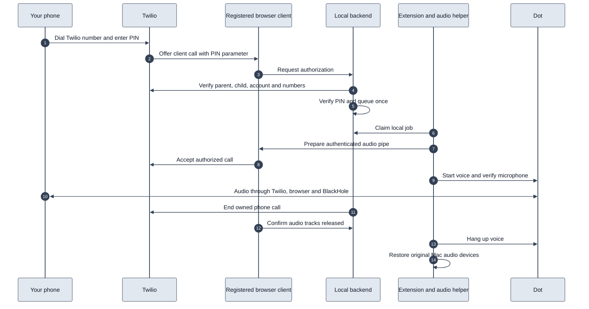

# Architecture and developer reference

Local incoming and outgoing phone calls with Dot. The Mac runs the queue, MCP tools, caller and PIN checks, browser controls, and audio helper. Twilio provides the telephone connection and registered browser client. Dot provides its own intelligence and voice.

The default call path uses a registered Twilio browser client. It does not start Cloudflare, use Media Streams, or need public HTTP access to the Mac. Outgoing calls use inline TwiML through Twilio's REST API. Incoming calls use a small Twilio-hosted TwiML Bin to collect a PIN and route to the client; all authorization decisions happen locally.

In the original developer installation, the existing `dot-phone-plugin` source, helper, and hosted plugin were retained as an explicit fallback. A fresh clone does not include that hosted service. This project has separate credentials, ports, native host identity, and runtime state. The installed **Dot Phone Local** connection uses Secure MCP Tunnel; the Twilio number now routes incoming calls to this project. See [cutover and rollback](CUTOVER.md). New configurations still default to calling disabled.

## Call lifecycle

For example, when you call your Twilio number, Twilio collects the six-digit PIN and offers the call to this project's registered browser. The local backend checks the actual parent and child call records with Twilio, verifies your saved caller number and PIN, and queues the call. The extension starts the native audio helper. Once the audio route is ready, the browser accepts and the helper starts Dot.



Outgoing requests follow the same local queue and audio preparation. The backend dials only the saved number after the browser confirms audio readiness. Dot starts after the phone answers. There is no diagnostic arm file or manual bridge-page step in the normal call path.

The browser remains registered while idle without opening the microphone. The extension creates a hidden Chrome offscreen document automatically on startup. The bridge no longer needs a visible tab. Dot's own page still opens for its voice session. Access tokens refresh before expiry. Native audio runs only during a call. Cancellation, phone hangup, browser loss, helper loss, and time limits all initiate cleanup. A persistent journal blocks automatic retries after an uncertain call-creation response.

## Components

- `src/registered-calls.mjs`: registered-client authorization, token renewal, provider calls, and durable recovery.
- `src/local-backend.mjs`, `local-main.mjs`, `local-queue.mjs`: private HTTP MCP, companion API, and SQLite queue.
- `browser/`: persistent registration, incoming call screening, per-call audio, and browser cleanup.
- `chrome-extension/`: automatic bridge startup, Dot controls, microphone selection, and native messaging.
- `mac-bridge/registered_call.py`: per-call 48 kHz PCM playback to BlackHole and verified audio restoration.
- `mac-bridge/companion.py`: the registered-client path is the default. Older transport code is retained only as an explicit legacy implementation.
- `prototype/registered/`: separate client-to-client audio experiment. Never use the saved-owner prototype as a no-phone test.
- `scripts/`: independent builds, installation, configuration, and incoming TwiML rendering.
- `test/` and `mac-bridge/test_*.py`: automated tests without provider calls or hardware audio.

For a fresh Mac, follow the numbered setup in the [README](../README.md).

## Tests

```sh
npm test
npm run test:python
npm run test:tunnel
```

These use mocked provider calls and audio devices, temporary HTTP/WebSocket listeners, and in-memory audio. They cover incoming PIN/caller checks, outgoing audio gating, at-most-once dialing, uncertain-result recovery, cancellation, token renewal, automatic browser registration, authenticated PCM, track release, and helper cleanup. No phone is dialed.

For a spoken Dot test, build with `--audio-test --enable-calling` and load or reload this project's extension. That diagnostic cannot invoke Twilio. It requires `whisper-cli` and `.runtime/ggml-base.en.bin`. It runs once per generated test ID and reports in `.runtime/browser-audio-test-result.json` and `.runtime/native-helper-result.json`.

The separate `registered_probe.py --native-audio` experiment creates temporary Twilio client-to-client calls and uses generated tones. It changes virtual audio routing and needs Chrome microphone access. It cannot dial a phone number. `test-session.py` and the saved-owner prototype can dial phones and are not unit tests.

See `VALIDATION.md` for observed results and remaining live checks. Historical extraction notes are in `reference/`.

## Resource isolation and limits

- Private backend and browser page: `127.0.0.1:8894`.
- Per-call native audio WebSocket: `127.0.0.1:8893`.
- Native host: `dev.dot_phone_call.helper`.
- macOS bundle: `dev.dot-phone-call.helper`.
- Login service: `dev.dot-phone-call.app`; the separately installed `dev.dot-phone-call.backend` service is retained only for older installations.

The helper refuses to take over an existing BlackHole default route. Physical devices and the signed-in Dot tab are still shared resources, so do not run simultaneous calls from both projects. Global Mac output routing can include audio from other applications. Dot-only output isolation is not part of this integration.

A lost outgoing REST response is deliberately not retried. The journal retains the uncertain intent and blocks subsequent calls until the provider outcome is reconciled. This prevents a timeout from placing a duplicate call. Credentials and runtime call records remain local and ignored by Git.

Provider references: [Twilio Device registration and tokens](https://www.twilio.com/docs/voice/sdks/javascript/twiliodevice), [TwiML Bin templating](https://www.twilio.com/docs/serverless/twiml-bins/getting-started), and [custom client parameters](https://help.twilio.com/articles/115011213347-Passing-Custom-Information-via-Requests-to-Twilio).

## Hidden bridge diagnostic and fallback

Build with `node scripts/build-mac-extension.mjs --enable-calling --backend=local --hidden-audio-test` to run one diagnostic after reloading the extension and granting microphone permission. Disable both backend calling flags during this test. It launches the native helper automatically and passes a 997 Hz tone through BlackHole 2ch, the real browser audio session, local Opus WebRTC, PCM playback, and BlackHole 16ch. It checks the received tone, closes all test tracks and streams, and never invokes the phone API. The test uses a muted audio element to match Twilio's remote playback lifecycle and a duplex BlackHole recorder to avoid conflicting CoreAudio streams. This verifies local audio transport; it does not prove a live telephone call or Dot response.

The packaged page contains the Twilio SDK and audio code. Its HTTP and WebSocket access requires the paired extension origin and existing local capabilities. The local backend reports `browser_context: offscreen` and microphone readiness. Registration stays active while idle with no microphone track open.

For rollback, rebuild with `node scripts/build-mac-extension.mjs --enable-calling --backend=local --tab-bridge`, then reload the extension while idle. This restores the localhost bridge tab. Do not run both bridge modes at once.

Verified on 2026-10-25: two hidden-page audio checks passed with 124 and 125 received Opus packets, approximately 997 Hz recovered at BlackHole 16ch, and zero dropped PCM chunks. The helper exited and its audio listener closed after each check. Backend restart recreated the hidden page automatically. Secure MCP Tunnel reported calling ready with `browser_context: offscreen`, and Chrome had no visible bridge tab. No telephone call was placed during these checks. A full Mac reboot and a live telephone call on this hidden-page build remain untested.

During development, a local `.runtime/hidden-audio-test-request.json` containing a fresh UUID `id` and an `expires_at` timestamp in milliseconds can request another audio diagnostic without reloading the extension. The backend exposes that request only while calling is disabled, no call is active, and expiry is less than ten minutes away. The extension executes each ID once. Remove the request and restore the saved calling settings after testing. Runtime files and credentials remain ignored by Git.
