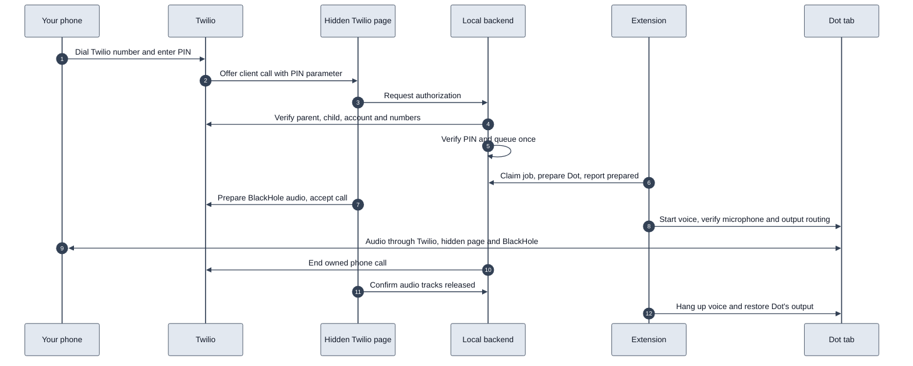

# Architecture and developer reference

Local incoming and outgoing phone calls with Dot. The Mac runs the queue, MCP tools, and caller and PIN checks in a local backend; a Chrome extension runs each call, controls Dot's tab, and carries the call audio. Twilio provides the telephone connection and a registered browser client. Dot provides its own intelligence and voice. See the [architecture diagram](architecture-diagram.html).

The call path uses a registered Twilio browser client. It does not start Cloudflare, use Media Streams, or need public HTTP access to the Mac. Outgoing calls use inline TwiML through Twilio's REST API. Incoming calls use a small Twilio-hosted TwiML Bin to collect a PIN and route to the client; all authorization decisions happen locally. Dot reaches the backend's tools through the **Dot Phone Local** plugin over OpenAI's Secure MCP Tunnel. New configurations default to calling disabled.

## Call lifecycle

For example, when you call your Twilio number, Twilio collects the six-digit PIN and offers the call to this project's registered browser client in a hidden extension page. The local backend checks the actual parent and child call records with Twilio, verifies your saved caller number and PIN, and queues the call. The extension's background worker claims it, prepares Dot's tab, and tells the backend the call is prepared. The hidden page prepares its BlackHole audio and accepts. When the call connects, the extension starts Dot's voice and verifies Dot's microphone and output routing.

No native helper is involved, and the Mac's default devices never change: Dot's tab routes its own playback to BlackHole 2ch, and the hidden page plays phone audio to BlackHole 16ch, which Dot uses as its microphone.



Outgoing requests follow the same queue and preparation. The backend dials only the saved number after the hidden page confirms its audio is ready. Dot starts after the phone answers.

The browser client stays registered while idle without opening the microphone. The extension creates the hidden Chrome offscreen document on startup and recreates it when needed. Dot's own page still opens for its voice session. Access tokens refresh before expiry. Cancellation, phone hangup, Dot hangup, browser loss, and time limits all run one idempotent finish: end the Twilio call, release browser audio, hang up Dot, restore Dot's output, and report the outcome. If the extension's worker restarts mid-call, it finishes that call once on start; the backend also ends a call whose extension stops checking in for 15 seconds. A persistent journal blocks automatic retries after an uncertain call-creation response.

## Components

- `src/registered-calls.mjs`: registered-client authorization, token renewal, provider calls, and durable recovery.
- `src/local-backend.mjs`, `local-main.mjs`, `local-queue.mjs`: private HTTP MCP, companion API, SQLite queue, and the call-progress log (`.runtime/app-backend.log`).
- `chrome-extension/calls.js`: the background worker's call runner: claims calls, prepares and starts Dot, watches the call, finishes it, and runs requested no-phone checks.
- `chrome-extension/background.js`, `content.js`: Dot tab selection and controls.
- `chrome-extension/microphone-route.js`: during an armed call, forces Dot's microphone to BlackHole 16ch and routes Dot's audio elements and audio contexts to BlackHole 2ch, then restores them.
- `chrome-extension/offscreen-control.js`: creates and checks the hidden Twilio page.
- `browser/`: the hidden page: persistent registration, incoming call screening, per-call audio, and browser cleanup.
- `browser/phone-voice.js`, `phone-voice-worklet.js`: Dot-to-phone telephone voice shaping on the audio thread (phone-band limit, bass cut, consonant lift, leveling, soft limiter).
- `browser/diagnostic.js`: the no-phone audio check.
- `mac-app/`: the menu-bar app and supervisor that keep the backend and tunnel client running.
- `scripts/`: builds, installation, configuration, and incoming TwiML rendering.
- `test/`, `scripts/test_setup.py`, and `mac-app/test_supervisor.py`: automated tests without provider calls or hardware audio.

For a fresh Mac, follow the numbered setup in the [README](../README.md).

## Tests

```sh
npm test
npm run test:app
npm run test:setup
npm run test:tunnel
```

These use mocked provider calls, browser APIs and audio devices, temporary HTTP listeners, and in-memory queues. They cover incoming PIN/caller checks, outgoing audio gating, at-most-once dialing, uncertain-result recovery, the call runner's sequence and every way a call ends, worker-restart recovery, cancellation, token renewal, automatic browser registration, Dot output routing and its gate, voice shaping, and track release. No phone is dialed.

See `VALIDATION.md` for observed results and remaining live checks. Historical extraction notes are in `reference/`; they describe code that has since been removed.

## Resource isolation and limits

- Private backend and browser page: `127.0.0.1:8894`.
- Login service: `dev.dot-phone-call.app`; the separately installed `dev.dot-phone-call.backend` service is retained only for older installations.

Calls select BlackHole devices per tab and per page, so only Dot's audio reaches the phone and the Mac's speakers and microphone stay usable. A call refuses to start with `MAC_DEFAULT_OUTPUT_IS_BLACKHOLE` if the Mac's default output is a BlackHole device, because every app's sound would then join the call. If Dot connects but its playback cannot be routed, the call fails with `DOT_OUTPUT_NOT_ROUTED` instead of playing Dot on the speakers. The BlackHole devices and the signed-in Dot tab are shared resources, so do not run simultaneous calls from two installations.

A lost outgoing REST response is deliberately not retried. The journal retains the uncertain intent and blocks subsequent calls until the provider outcome is reconciled. This prevents a timeout from placing a duplicate call. Credentials and runtime call records remain local and ignored by Git.

Provider references: [Twilio Device registration and tokens](https://www.twilio.com/docs/voice/sdks/javascript/twiliodevice), [TwiML Bin templating](https://www.twilio.com/docs/serverless/twiml-bins/getting-started), and [custom client parameters](https://help.twilio.com/articles/115011213347-Passing-Custom-Information-via-Requests-to-Twilio).

## No-phone audio check and fallback

`scripts/verify-setup.py --audio` writes `.runtime/hidden-audio-test-request.json` with a fresh ID. The backend exposes that request only while calling is disabled, no call is active, and expiry is less than ten minutes away. The extension runs each ID once: the hidden page plays a 997 Hz tone into BlackHole 2ch (standing in for Dot), passes it through the real call audio session and voice shaping, a local Opus WebRTC loop, and its own playback to BlackHole 16ch, and records BlackHole 16ch. The backend accepts the result only for the requested ID and writes `.runtime/audio-diagnostic-result.json`. This verifies local audio transport; it does not prove a live telephone call or Dot response.

The packaged page contains the Twilio SDK and audio code. Its HTTP access requires the paired extension origin and existing local capabilities. The local backend reports `browser_context: offscreen` and microphone readiness. Registration stays active while idle with no microphone track open.

For rollback to a visible bridge tab, rebuild with `node scripts/build-mac-extension.mjs --enable-calling --backend=local --tab-bridge`, then reload the extension while idle. Do not run both bridge modes at once.
