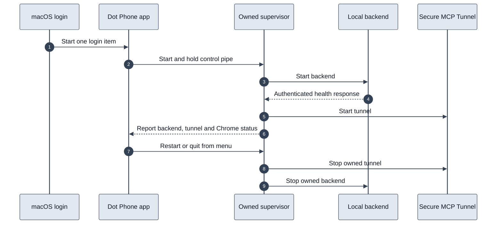

# Dot Phone background app

The menu-bar app manages the local backend and Secure MCP Tunnel through one login service named `dev.dot-phone-call.app`. A fresh installation uses `scripts/install-background-app.py --fresh --install` after the README setup steps. Existing installations can migrate this project's two older login services with `--install`. It does not modify Twilio routing, plugin identity, credentials, calling flags, Chrome extension identity, or the on-demand audio helper.

The current build lives at `.runtime/Dot Phone.app`. It is locally signed and references this checkout and its installed runtimes. It is not yet a standalone, notarized distribution package. Keep this project at its current path.

## Operation

At login, macOS launches the menu-bar app. The app starts an owned supervisor, which starts the backend first and waits for its authenticated local health endpoint before starting the tunnel. Chrome reconnects using the existing extension. Idle checks do not call Twilio or start audio.

The menu offers status, Restart services, Open logs, Open project, and Quit Dot Phone. Restart is disabled while a call is active. The supervisor independently checks this guard, so a stale menu cannot interrupt an active call. Confirmed quit during a call invokes the existing end-call tool locally and waits for call and audio cleanup. If cleanup cannot be confirmed, normal quit is refused and services remain running.

A normal quit exits successfully, so launchd does not immediately reopen the app. Opening it again or the next login starts it. Unexpected app exits are restarted by launchd. The supervisor restarts crashed services with bounded backoff. It never starts another copy while its owned child is running and refuses to adopt an occupied port. The app cleans the supervisor's dedicated process group if that supervisor crashes. Closing the app control pipe or losing the parent triggers service shutdown.

## Files and recovery

- `mac-app/App.swift`: native menu and process ownership.
- `mac-app/supervisor.py`: health checks, lifecycle, active-call protection and child recovery.
- `.runtime/background-services.json`: existing service commands; credentials remain in their original private files.
- `.runtime/app-status.json`: sanitized current status and owned process IDs.
- `.runtime/app-backend.log`, `.runtime/app-tunnel.log`, `.runtime/menu-bar-app.log`: local service logs.
- `.runtime/login-items-before-app/`: exact recoverable copies of the prior two login-agent definitions.

Use `scripts/install-background-app.py --restore` to remove a fresh installation's app login item, or restore the two previous login services after a migration. Private configuration is retained. The installer only operates on this project's exact service names and verifies command ownership. The old hosted project's sources and services are outside this migration.

## Validation

- Native app compiled and code signature verified.
- 88 JavaScript tests pass, including authenticated menu-bar status with no provider request.
- Six supervisor tests use real isolated subprocesses and fake local services: startup/restart/quit, backend crash recovery, active-call restart blocking and explicit quit, app control-pipe closure, duplicate supervisor rejection, and occupied-port protection.
- Live installation and process-recovery results are saved in `.runtime/menu-bar-live-test.json`. No phone calls are made by these checks.
- Full reboot/login and the macOS System Settings grouping have not been tested. Old developer names may remain in System Settings, including entries belonging to other projects. One installed launch agent is verified independently of how System Settings labels it.

The owner supplied a screenshot confirming the native menu shows Ready for calls, the three connection statuses, Restart services, Open logs, Open project, and Quit Dot Phone. Live backend recovery took 7.55 seconds. Supervisor-crash recovery took 9.08 seconds and left no old child processes. Shutdown and relaunch results are recorded in the private live-test artifact. No phone calls were placed during this packaging change.
