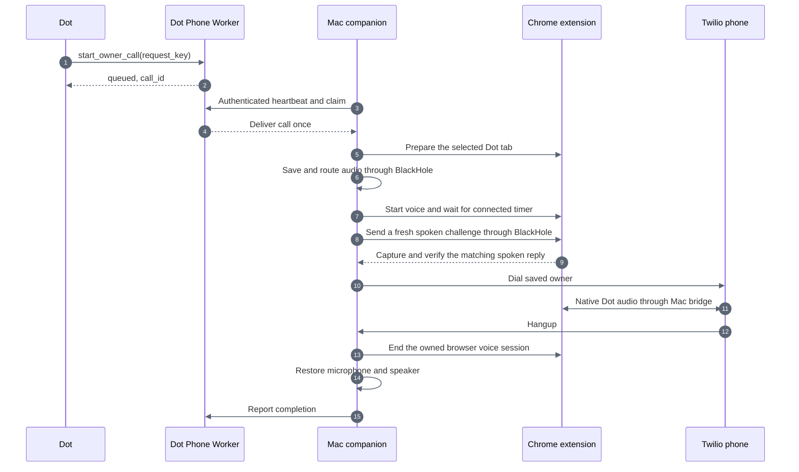

> Historical source-project notes. These describe earlier tests and transports, not an activated installation of this project. Use the root README for current status.

# Automatic Dot phone calls

The Chrome native messaging helper is documented in [On-demand setup](ON-DEMAND.md).
It replaces the permanent companion process with a helper launched for each
operation. Audio-test builds disable phone dialing; normal calling is enabled separately. The legacy
setup below remains available as a historical reference. Current ordinary calls
check the local route and public bridge, ring the phone, then start Dot on answer.
The spoken challenge is diagnostic-only. See the current sequence and validation
limits in [On-demand setup](ON-DEMAND.md#answer-before-starting-dot-24-october-2026).

Dot Phone now queues owner-only calls for the Mac companion. The companion starts the account's Dot browser voice session, connects Twilio, ends the browser call after phone hangup, then restores the saved Mac microphone and speaker. Dot supplies all intelligence and voice. Existing personal-calls backends remain separate.

## Usage

### Audio verification gate, 23 October 2026

Every attempted call now opens the virtual audio streams, starts browser voice,
and requires a fresh spoken challenge to return through BlackHole before any
Twilio call is created. `browser_audio_check.py` generates the test phrase with
macOS `say` and checks the response using local `whisper-cli`. These tools are
used only for the test, never as the telephone voice or conversational model.
Silence, unrelated audio, recognition failure, missing dependencies, or a
failed public-tunnel check blocks dialing. The same open audio streams are
retained for the call, and test buffers/counters are cleared before dialing.

The local check requires `/opt/homebrew/bin/whisper-cli` and
`.runtime/ggml-base.en.bin`. The current model downloaded from the official whisper.cpp
model repository has SHA-256
`a03779c86df3323075f5e796cb2ce5029f00ec8869eee3fdfb897afe36c6d002`, verified
against the official repository metadata. Temporary test recordings and transcripts are
deleted automatically; the diagnostic CLI can explicitly retain evidence.
Background Mac audio must be paused because the current default-output routing
also captures other apps. A matching response proves the challenge round trip,
but does not isolate the Dot tab from other simultaneously playing audio.

Read-only preflight returns `preflight_required`, not `ready`, when a compatible
companion is online. `can_request_native_dot_call` means a request can be queued;
`can_place_native_dot_call` remains false because audio is not verified until
the requested session runs its check. The Worker rejects old companions without
`audio_guard_version: 1`. Existing requests are still delivered at most once.

Calls without a media stream, provider failures, lost control, and silent Dot
audio report failure rather than successful completion. Browser hangup must be
positively confirmed before restoring the physical microphone.

Verification: 18 Node tests, 23 Python tests, and the real local Worker/OAuth
integration test passed. Live browser challenge attempts did not pass. The
diagnostic return contained background music, not the requested
three-word response. A separate dictation test returned an empty composer after
the synthetic phrase was injected into BlackHole. The owner subsequently confirmed Chrome explicitly selected the MacBook
microphone. Changing the macOS default therefore did not establish the browser
input route. Extension v0.1.3 now requires an exact BlackHole 16ch browser track. No phone call was made during these checks. Normal
Mac audio was restored after each browser test.
The unrelated music captures were removed after diagnosis.

Ask Dot to call you using Dot Phone. The tool takes a unique request key and optional duration, default 120 seconds, maximum 600 seconds. It has no phone-number argument or arbitrary script input. Queued does not mean connected; use `get_owner_call` to see progress. `end_owner_call` cancels an outstanding call or hangs up an active one.

Keep the Mac awake, online, and Chrome running with the companion extension enabled. A logged-out Dot tab or missing voice controls blocks dialing. The Chrome extension can open the Dot page when necessary. It never reads chat messages or edits the composer. The extension inspects the visible call buttons, connected timer, and owned
audio track settings. It forces BlackHole 16ch only during an owned call and
returns ordinary microphone selection to Chrome after confirmed hangup.

Calls temporarily use BlackHole 16ch as the default microphone and BlackHole 2ch as the default speaker. Pause other Mac audio because output using that default can reach the phone. Physical microphone audio is not used by the bridge.

## Components

- `src/call-queue.mjs` and `src/companion-do.mjs`: one owner-specific Durable Object, persisted call lifecycle and idempotency for 24 hours.
- `src/worker.mjs`: existing OAuth MCP server, plus authenticated companion pulse/update endpoints.
- `mac-bridge/launcher.swift`: menu-bar Mac app that owns microphone permission, tests both BlackHole paths, then runs the existing Python companion.
- `mac-bridge/companion.py`: paired local WebSocket on 127.0.0.1:8892, call setup and cleanup.
- `chrome-extension/`: reviewed extension source. The installed unpacked package is `.runtime/dot-phone-extension`; its local pairing token is generated privately.
- `mac-bridge/bridge.py`: existing audio bridge, reused with lifecycle callbacks. Manual test launcher remains available.
- `mac-bridge/browser_audio_check.py`: fresh speech challenge and local response verification before each dial.

The local browser token and cloud companion token are distinct. Twilio credentials remain in the existing private file on the Mac. The cloud Worker cannot run arbitrary Mac commands, open arbitrary websites, or change the recipient.

## Install and maintain

Run `node scripts/build-mac-extension.mjs` to prepare the unpacked extension. Load `.runtime/dot-phone-extension` through Chrome's extension manager. Chrome grants chatgpt.com host access; the source confines its UI actions to `/dots/` call controls. The extension also connects only to the fixed local companion port. It has no externally connectable page interface.

Build the permission-owning app with `python3 scripts/build-mac-app.py`, then run `.venv/bin/python scripts/install-mac-companion.py --native-app`. Open `.runtime/Dot Phone Call Helper.app` and grant its microphone permission. The app selects only BlackHole devices and performs a generated-tone test before accepting calls. The microphone permission is required even for virtual capture.

The login configuration at `~/Library/LaunchAgents/dev.dot-phone-call.helper.plist` opens that app at the next login. The app restarts its Python child after process failure. Use the **Dot Phone** menu-bar item to quit; this lets the child end any call and restore audio. Keep the project at its installed path. The older direct-Python launch mode is unsuitable for unattended audio on this Mac: macOS denied its capture because the responsible Python binary lacks an audio-input entitlement. Do not replace or re-sign the system Python installation.

The native app is locally ad-hoc signed, not distributed or notarized. Rebuilding can require reapproval of microphone permission. Its audio check writes only amplitude/frequency results to `.runtime/native-audio-check.log`; it does not record speech.

Dot Phone requires `phone:call` in addition to its existing `phone:status` permission. Reconnect the existing ChatGPT app when prompted. Read-only tokens remain read-only. `scripts/approve-connection.mjs` approves only the owner-authorized request shown on the consent page.

Click the extension's toolbar icon while viewing the desired Dot tab to remember it. Without a remembered tab, the extension uses an active Dot tab, then the most recently accessed Dot tab. Setup no longer embeds a particular tab ID. It brings the selected tab and window forward before startup and cleanup. Versioned control messages replace stale page handlers without reloading the page or losing drafts.

## Failure behavior

- Missing companion or stale heartbeat: reject immediately, no delayed phone call.
- Before dialing, the bridge verifies a public WebSocket round trip through the temporary tunnel. An unreachable tunnel fails with `PUBLIC_BRIDGE_UNREACHABLE`; this probe neither claims the phone stream nor opens audio devices, and sends no Twilio credentials.
- Queued requests expire after 45 seconds. Claiming is at most once. An uncertain network response never triggers a second dial.
- One call at a time. Local guard also checks the Twilio account for existing calls. A separate prototype cap is 60 requests per rolling 24 hours; existing personal-calls limits are unchanged.
- Browser or cloud control loss ends an active phone call. The extension also has a disconnect watchdog and maximum-duration watchdog.
- Normal cleanup ends the browser voice session before restoring the physical microphone. If browser hangup cannot be confirmed, audio remains on the virtual devices and new calls are blocked. On reconnection, the extension closes its owned session and the companion restores devices.
- If the Mac or process crashes, the saved audio snapshot survives. Restarting the companion and extension performs recovery. Manual restoration remains available after you have ended any browser voice call: `.runtime/audio-routing restore .runtime/mac-audio-original.json`.
- Failure reports and cloud heartbeats continue while browser cleanup is pending. Cleanup cannot leave Dot waiting on a stale starting status. The physical microphone still remains isolated until browser hangup is confirmed.
- Logs contain lifecycle states and audio counters, not recordings, transcripts, or credential values. Dot and Twilio retain their own normal service behavior.

The native voice connection depends on Dot's current browser UI. If labels or call indicators change, the extension fails closed. Quick Tunnels remain temporary development infrastructure. This is a personal prototype, not a production availability guarantee.

## Verification

The local Worker integration test verifies real OAuth grants, status-only denial of dialing, all five tools, Durable Object persistence, at-most-once claim, and cancellation. Node regression tests cover 16 cases. Python tests cover 13 audio and companion cases, including unpaired browser rejection and call shutdown on browser disconnect. The preceding supervised 120-second test was confirmed by the owner as a clear back-and-forth conversation. Automatic browser startup and cleanup require a separate live test after extension installation.

Extension v0.1.2 adds active-tab selection, foreground startup, bounded browser messages, and version checks. Tests reproduce the old tab-selection error and the cleanup-blocked heartbeat before verifying the repairs. A live automatic phone test is still required; passing mocked browser tests is not that evidence.

On 23 October, v0.1.2 successfully started Dot voice and dialed the owner, but the phone had no Dot audio. Cleanup after hangup succeeded. Counters showed incoming phone audio and a zero Dot peak. The same generated-tone test passed under Codex and failed with zero RMS under launchd. macOS TCC logs explicitly denied microphone capture to the responsible Python binary because its hardened-runtime audio-input entitlement was missing. The locally signed native app with microphone usage text and audio-input entitlement then passed both BlackHole tests (RMS 0.0533, 997.6 Hz), and paired with extension v0.1.2. The following phone test was still silent. The actual AudioBridge subsequently passed generated-tone tests in both directions under the native app (RMS 0.0562 and 0.0398), but these do not establish that Chrome selects those devices or that Dot speech reaches the phone.

A later call ended at pickup with zero seconds of media. Twilio recorded error 11100 and a 502 status callback. A no-call tunnel probe failed DNS resolution through the Mac's configured resolver; Cloudflare's public DNS resolved that same hostname. This does not establish the exact cause of Twilio's invalid-URL error. A new bounded WebSocket preflight prevents dialing when the bridge cannot verify its public connection. Sixteen Python tests pass, including public-502 rejection, no dialing after failed preflight, and a probe that leaves the phone stream available. Chrome Control was unable to attach to the Dot tab, so browser audio routing remains unverified.

## Browser microphone routing, v0.1.4

Chrome can retain an explicitly selected MacBook microphone when the macOS
default changes. The extension now installs a MAIN-world getUserMedia wrapper
at document start. Before clicking Start call, it enumerates BlackHole 16ch and
arms an exact deviceId constraint for the owned session. It verifies the actual
returned track's deviceId, live state, enabled state, and mute state. A connected
timer alone is insufficient. Missing permission, missing BlackHole, a replaced
hook, or an unverified track prevents dialing. The regular phrase challenge
still verifies the separate return-audio path before Twilio is contacted.

After confirmed hangup, the override is removed and normal microphone requests
pass through unchanged. If hangup cannot be confirmed, owned tracks stop and
the route remains blocked until recovery. Pending capture grants are stopped
after cancellation, and the route has its own bounded lease. The MAIN-world
interface contains no pairing token and does not expose audio samples.

After building the unpacked extension, reload it in Chrome and reload the Dot
page once. The companion requires v0.1.5. A page without the early microphone
hook returns DOT_MICROPHONE_RELOAD_REQUIRED instead of attempting a call.

For an explicitly requested local browser-only test, create the private empty
file `.runtime/browser-audio-test-request.json`. The running native companion
consumes it only when idle and ready, and only within 60 seconds of creation.
It starts Dot voice, verifies the microphone, runs the speech challenge, hangs
up, and restores audio. This path never calls the telephone bridge or Twilio.
The result is written to `.runtime/browser-audio-test-result.json`, including
challenge text on success and a failure code otherwise. No recording is retained.
Do not create this request as part of ordinary unattended maintenance.

The first v0.1.3 browser-only test stopped before Start call with
BLACKHOLE_MICROPHONE_NOT_FOUND. It restored audio and made no phone call.
The owner confirmed Chrome's settings list both BlackHole 16ch and 2ch.
Version 0.1.4 accepts case/whitespace and a parenthesized device-label suffix,
and reports the BlackHole labels and input count visible to the Dot page on
lookup failure. Browser device IDs are not included in those diagnostics.
Validation at this stage: 32 Node and 25 Python tests pass. The following live result separately verifies a spoken round trip; neither
a connected timer nor regression tests alone would prove it.

## Verified browser-only round trip, 24 October 2026

The installed extension and native companion are both on routing protocol
v0.1.4. Chrome exposed the actual microphone label `BlackHole 16ch (Virtual)`;
the previous exact-name lookup excluded it. The updated extension forced its
exact deviceId and verified the returned live audio track before the challenge.

The successful test requested `silver mountain rabbit`. The captured BlackHole
2ch return was recognized locally as `Silver Mountain Rabbit`, with peak 0.1639
and 0.99 seconds above the activity threshold. The result recorded verified=true,
dialed=false, microphone_verified=true, and audio_restored=true. Browser hangup
was confirmed. No telephone call was created by this diagnostic.

An earlier v0.1.4 challenge returned a mismatch after the microphone check
passed. That attempt did not retain the recognized text, so its exact cause
remains unknown. One successful round trip establishes the working path, not
universal reliability. Every future telephone request still runs its own fresh
speech challenge and blocks dialing if either microphone or reply validation
fails. Telephone ringing, pickup, and a complete conversation have not been
retested after this change.

## Audio checker repair, 24 October 2026

The next owner-requested call failed during the browser speech check. The log
contains no dialing_owner or call_created event for that attempt. Its roughly
46-second duration describes the browser session, not a telephone connection.
The microphone track was verified as BlackHole 16ch (Virtual), and cleanup
restored audio. That version discarded the expected phrase and recognized text
on normal-call failure, so this particular mismatch cannot be reconstructed.

A deterministic capture test reproduced loss of a correct early response: the
old checker discarded all return audio until the injected prompt ended plus
300 ms. Another test reproduced rejection of acknowledgments between required
words. Prefix acknowledgments already passed the old matcher.

The checker now keeps return audio throughout the stimulus and response window.
It uses a shorter prompt asking Dot to reverse three distinct random words.
Direct echo of the stimulus has the wrong order and cannot pass by itself.
The matcher requires every expected word in order within a window allowing at
most four extra words. Missing words, stale challenges, the original stimulus
order, silence, and unrelated speech still fail. The test never dials on failure.

On mismatch or silence, the companion reports stage=browser_audio_preflight,
phone_dialed=false, the expected response, challenge words heard in their
observed order, peak, and active duration. The Worker validates and stores only
these bounded fields for get_owner_call. It does not expose arbitrary speech
or a raw transcript. Failure diagnostics are covered by the real local MCP and
Durable Object integration test. Worker deployment:
bb304ec6-0de1-4f92-840b-71528e52adaf.

A subsequent browser-only validation exposed a separate startup race: Start
call returns before Hang up appears. Extension v0.1.5 waits for that asynchronous
transition rather than immediately reporting DOT_VOICE_ENDED_BEFORE_CONNECT.
The wait remains bounded and actual microphone verification remains mandatory.

Validation so far: 35 Node and 29 Python tests pass, including early response,
acknowledgment tolerance, missing-word/echo rejection, diagnostic propagation,
and delayed browser controls. One revised live speech challenge passed with
a greeting followed by `tiger river orange`; another attempt hit the startup
race before the extension repair. Additional live checks follow activation.

The next diagnostic isolated a recognition mismatch: expected `eagle river yellow`,
recognized `Thank you. I'm here. Eagle Riffer Yellow.` The missing middle-word
check correctly blocked dialing. The local ASR model was upgraded from tiny.en
to base.en using the same whisper-cli, with SHA-256 verified against the official
whisper.cpp model repository. No expected-word decoder prompt or grammar is
provided. An offline speech test recognized `Eagle River Yellow` in 0.86 seconds.
The owner then explicitly requested one end-to-end phone call. Its own fresh
browser-audio check must pass before Twilio is contacted.

## Confirmed end-to-end call, 24 October 2026

Call c4a442eb-23d2-4d2c-9d12-3bd33472005b passed its fresh browser speech
check with base.en (reply peak 0.285), rang the owner, connected, and completed.
The owner explicitly confirmed clear audio and correct responses in both
directions. Bridge metrics recorded 99.94 seconds of Dot audio and 92.86 seconds
of phone audio, with no audio xruns. The queues recorded 398 capture drops and
53,752 dropped playback samples, so this establishes working conversation, not
lossless transport. Browser end, original audio restoration, and cleanup all
completed successfully. Evidence is saved in .runtime/end-to-end-verification.json.

A separate subsequent request, 0769890a-89ca-4a7a-8bbb-211435677505, failed
before dialing. Its expected response was `tiger window yellow`; recognized
challenge words were `yellow window tiger`, the original stimulus order.
The diagnostic proves the required reversed reply was not recognized, but does
not establish whether this was echo, Dot repeating the stimulus, or recognition
error. Browser end and original audio restoration succeeded for this attempt
also. No retry was initiated by this verification session.

## Spoken order and startup timing repair, 24 October 2026

The owner reported that Dot's transcript for the failed `tiger window yellow`
challenge said "in order" instead of "in reverse order". The current source
and a regenerated Samantha prompt both contain "reverse order". Local base.en
transcription preserves that instruction after the same mu-law encoding used
by the bridge. Replaying the reported `yellow window tiger` response through
the real checker reproduces DOT_AUDIO_REPLY_MISMATCH. The historical injected
audio was not retained, so loss in transport versus Dot recognition cannot be
proven retrospectively. A new baseline session using the old wording passed,
confirming that the failure is intermittent.

The spoken prompt now specifies the order twice. After naming the three words,
it explicitly requests "the last word, then the middle word, then the first
word." The expected sequence is never spoken in the stimulus, and echo/stale
response rejection remains intact. Each attempt logs the generated prompt,
expected response, and prompt version locally; it does not log conversation
speech. No extension update or Worker deployment is required.

Two fresh sessions passed with the clearer wording. A third returned only Dot's
greeting, without any challenge words. This exposed a separate suspected
startup overlap. The checker now waits at least three seconds and requires a
full second of quiet before playing the challenge. Persistent sound fails
closed after ten seconds as DOT_AUDIO_NOT_QUIET. Cancellation remains active
during this wait. Diagnostic runs also retain startup timing and bridge
counters to distinguish a missing reply from dropped playback in future checks.

Regression validation: 35 Node and 32 Python tests passed. The tests cover
explicit positional wording, delayed greeting completion, bounded continuous
speech, cancellation, early responses, echo rejection, and existing lifecycle
guards. Live validation results are in .runtime/prompt-order-validation.json.

The first validation with the greeting wait captured `Evo, window, silver` for
expected `eagle window silver`, with zero playback drops. That attempt remained
blocked. To reduce recognition errors caused by a mostly silent capture, the
checker now trims leading and trailing silence before ASR and retains 250 ms
of padding on each side. Energy validation still uses the original samples;
all expected words must still match. The capture regression verifies that an
early reply survives and that the recognizer receives the short speech region.
The first live check with all changes passed with `Dolphin, River, Yellow`,
using 2.28 seconds of recognition audio after a 4.06-second greeting wait.

Final live validation: three consecutive fresh browser-only sessions passed
with the combined prompt, greeting wait, and speech-window changes. Replies:
- dolphin river yellow; recognition window 2.28 seconds.
- rabbit window purple; recognition window 2.11 seconds.
- rabbit river yellow; recognition window 14.46 seconds.
All three verified BlackHole 16ch, ended the browser session, and restored
original audio devices. No telephone was dialed. Final companion status is
ready, idle, and free of pending cleanup. These runs establish the repaired
path works; they do not prove that speech recognition can never fail. The
historical loss of "reverse" remains unproven at the audio-transport level.

## Early audio verification, 24 October 2026

The checker previously collected the full spoken prompt plus 22 seconds before
starting ASR, even when Dot had already completed the correct reply. It now
starts recognition after the prompt finishes and the return channel is quiet
for 600 ms. Capture continues while ASR runs. A verified reply returns
immediately to the existing dialing path. A greeting or partial reply keeps
the window open, and new speech can trigger another recognition. Unchanged
silence does not cause repeated recognition. At the deadline, any remaining
speech gets a final check. The maximum response collection window remains
22 seconds; silence, missing words, wrong order, and cancellation cannot pass.

A pending recognizer is canceled and cleaned up before temporary files are
removed. Existing active-call checks still run before Twilio creates a call.
No additional phone call was placed during performance testing. New timing
logs report total verification time, prompt duration, response decision time,
unused response window, and recognition attempts.

All 37 Python tests pass, including early success, continued capture during
recognition, greeting followed by a later valid reply, wrong-response deadline,
silence, and cancellation during ASR. A baseline live browser-only test took
45.23 seconds from local request to cleanup. Detailed before/after measurements
are stored in .runtime/early-audio-validation.json. These include browser
startup and cleanup but exclude tunnel setup and Twilio ringing.

All three fast live sessions passed and restored audio. Browser-only request
to cleanup durations were 26.67, 26.95, 28.4 seconds. Median 26.95 seconds
versus the 45.23-second baseline, saving 18.28 seconds or 40.4 percent.
The fixed response window had 16.28, 16.6, 16.14 seconds left when verification
finished. Two sessions needed two recognitions because a greeting came first;
both still completed early. These are browser-only measurements, not measured
phone ring times. Normal audio restoration and idle readiness were confirmed.

## Public bridge readiness repair, 24 October 2026

Call c0e1e9ef-94e9-4146-9018-6f38bb075ec5 failed before the audio challenge
and before dialing. The old public connection check discarded individual
network errors, so the historical underlying cause cannot be recovered.
Two fresh probe-only runs reproduced DNS lookup failures for newly generated
tunnel hostnames. In the second run the configured resolver returned no address
while Cloudflare's public resolver returned valid public addresses.

The bridge now falls back to verified HTTPS DNS for only its exact generated
tunnel hostname when system DNS fails. Normal TLS hostname verification stays
enabled. It does not change system DNS settings. Two fresh tunnels passed with
this fallback, but a third hostname was unavailable through both resolvers.

The companion now waits for tunnel registration and verifies a public TLS and
WebSocket roundtrip before opening browser voice or changing audio devices.
A DNS failure permits one replacement tunnel, with the failed process cleaned
up first. Other errors and a second DNS failure stop the request. This recovery
runs before dialing and cannot retry a telephone call. The bridge retains its
second public check after browser startup and its spoken audio check before
creating a Twilio call.

Failures now expose a sanitized reason, attempt count, elapsed time, and
phone_dialed=false through the Worker. URLs, probe tokens, and raw errors are
excluded. Worker version 25a47ed6-37d4-4edd-9e08-c24d82480e44 is deployed.

Validation: 45 Python tests and 37 Node tests passed, along with the Worker
build and local OAuth/MCP integration test. Deterministic tests cover DNS-only
replacement, terminal second failure, non-DNS failure, cancellation cleanup,
and preventing browser/audio startup when the public check fails. The final
live production startup path became ready in 7.98 seconds on its first tunnel;
a second public roundtrip passed on that same route. No telephone call or
browser voice session was started by these network tests. Results are stored
in .runtime/public-tunnel-final-validation.json. External DNS failures can
still prevent a call; the successful probe does not establish phone ring time.

## ChatGPT macOS app audio validation, 24 October 2026

The native ChatGPT app passed two spoken challenges through the existing
BlackHole audio bridge without using Chrome, the extension, a public tunnel,
or Twilio. The user found no microphone or speaker selectors in the app.
Setting macOS default input to BlackHole 16ch and output to BlackHole 2ch
before starting the native Dot call was sufficient for this session.

The test injected generated speech through the same 8 kHz mu-law codec and
BlackHole playback path used for telephone input. It captured only the virtual
return channel and recognized each reply locally. Reversed word order rejects
an echo of the stimulus:

| Stimulus | Expected and recognized reply | Check duration |
| --- | --- | --- |
| silver, garden, rabbit | Rabbit Garden Silver | 18.61 seconds |
| orange, garden, eagle | Eagle Garden Orange | 17.35 seconds |

Both checks had zero audio xruns and zero dropped playback samples. Capture
drop counters include discarded queued audio while awaiting manual connection
and recognition, so these results establish working speech roundtrips, not
lossless transport. Evidence is in .runtime/native-audio-probe-result.json.

The isolated probe_native_audio.py diagnostic holds the companion lock and
has no phone-dialing or browser-control path. Local controls are tied to a
fresh test ID. After testing, it stops audio and waits for explicit manual
hangup confirmation before restoring the original macOS audio devices. If
confirmation is missing, it retains virtual routing and the recovery snapshot.

The user started and ended this call. Computer-use access to com.openai.codex
was blocked by the tool's safety policy, so automatic native call controls
remain unverified. The successful audio test supports replacing the browser
audio endpoint, but does not establish unattended start, status, hangup, or
recovery. Chrome and the extension remain installed and the production call
path is unchanged. No phone was dialed. Original devices were restored and
the routing snapshot was removed after the user confirmed hangup.
