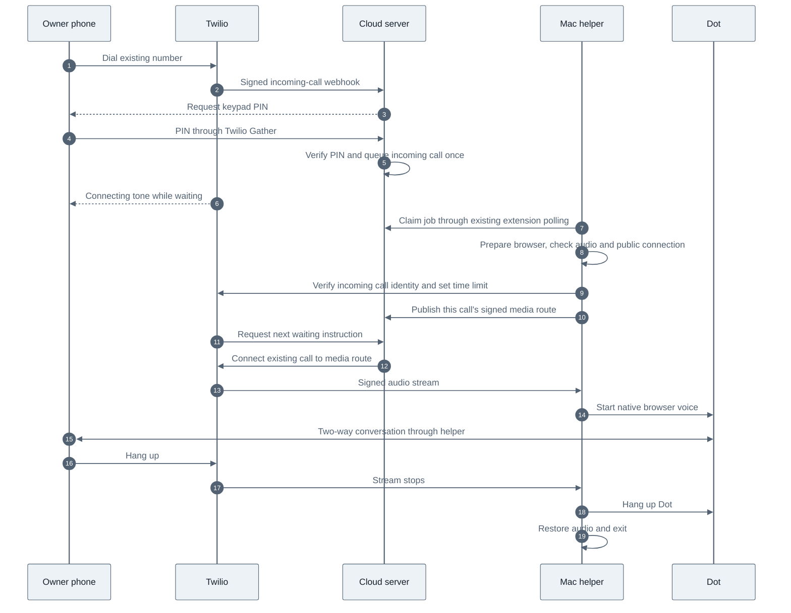

> Historical source-project notes. These describe earlier tests and transports, not an activated installation of this project. Use the root README for current status.

# Call Dot from your phone

Dial the existing Twilio number from the saved owner phone and enter the six-digit
PIN on the keypad. The private number and PIN are in
`.secrets/inbound-calling-details.txt`. Keep the Mac awake with Chrome and Dot
signed in. The extension starts the helper automatically; no extension reload
or permanently running helper is needed.

Twilio handles the telephone connection and the fixed PIN prompt. Dot supplies
the conversation and its voice through the existing BlackHole audio bridge.
No extra language model handles the conversation. The Opus prototype is separate.

## Connection flow



An incoming call is adopted by its provider call ID. The helper never submits
an outgoing `POST /Calls.json` for this path. It rechecks the account, caller,
called number, inbound direction and live status directly with Twilio before
attaching. Other active calls still block connection. Dot starts after signed
media arrives, preserving its opening words.

## Access and cleanup

- Only Twilio-signed requests for the configured account, called number and
  saved caller are accepted. A PIN is required in addition to caller ID.
- PINs are generated locally and stored in owner-only files. The Worker stores
  a salted PIN hash as a secret. The application does not store submitted digits.
- Three incorrect attempts end a call. Ten failures across calls block further
  attempts for the remainder of a rolling 15-minute window.
- Retries cannot enqueue a second job or revive a call after hangup. Only the
  helper instance that claimed a job may publish its media route. MCP status
  responses omit that route.
- The waiting loop is bounded at 90 seconds. Queued hangups cancel before pickup;
  hangups during setup signal the running helper. Twilio status polling provides
  another check if a callback is delayed. No recordings are enabled by this flow.
- A connected call has a ten-minute provider time limit. Ending the phone call
  stops browser voice, restores audio devices, and releases the helper. The
  existing Dot hangup tool also selects an active inbound call.

## Tests and deployment

The local Worker integration test exercises the compiled production bundle,
real Durable Object storage, signed webhooks, caller/PIN checks, queue claim,
bridge publication, waiting audio and hangup. Python tests adopt a simulated
incoming call and pass audio in both directions over a signed local WebSocket.
They assert that the inbound path never creates an outbound call. Existing
outbound, OAuth, extension, first-audio and cancellation regressions also run.

```sh
npm test
.venv/bin/python -m unittest discover -s mac-bridge -p 'test_*.py'
node scripts/test-worker.mjs
node scripts/test-inbound-worker.mjs
.venv/bin/python scripts/test-native-audio-route.py
```

Build the Worker before its integration tests:
`wrangler deploy --dry-run --outdir .runtime/worker-build`.

`scripts/configure-inbound.py` prepares private credentials without remote
changes. Upload `.secrets/inbound-worker-secrets.json` using Wrangler secret bulk,
then deploy the Worker. `scripts/check-inbound-live.py` checks the real endpoint
with official Twilio signatures but never submits a valid PIN or creates a job.
Only after it passes, run `scripts/configure-inbound.py --activate` to replace
the existing demo handler. That command saves the number's old voice and status
settings in `.secrets/inbound-number-backup.json`; SMS settings are untouched.

A real inbound carrier call and live Dot conversation require the owner to dial
the number. Automated checks do not establish that final end-to-end result.

Enabled on 24 October 2026 with Worker version
`3ddd27a6-2cf0-428e-8589-2dcc8a833936`. The saved Twilio number's voice and status
webhooks were read back and confirmed after activation. The live queue reports
`inbound_supported: true`, Chrome online, and no active call. Activation waited
until the deployed inbound queue operations passed the live checks.

Verification passed 93 Python tests, 63 JavaScript tests, both Worker integration
scripts, and the installed helper's two-way BlackHole test. Live requests signed
with the official Twilio Python validator confirmed signature rejection, caller
restriction, the PIN prompt, incorrect-PIN rejection, and the waiting tone.
Those live checks never submitted a valid PIN or queued a job. No phone call was
placed. Results are in `.runtime/inbound-live-check.json` and
`.runtime/inbound-native-audio.json`.

References: [incoming webhooks](https://www.twilio.com/docs/usage/webhooks/voice-webhooks),
[keypad Gather](https://www.twilio.com/docs/voice/twiml/gather),
[two-way Media Streams](https://www.twilio.com/docs/voice/media-streams), and
[request validation](https://www.twilio.com/docs/usage/security).
