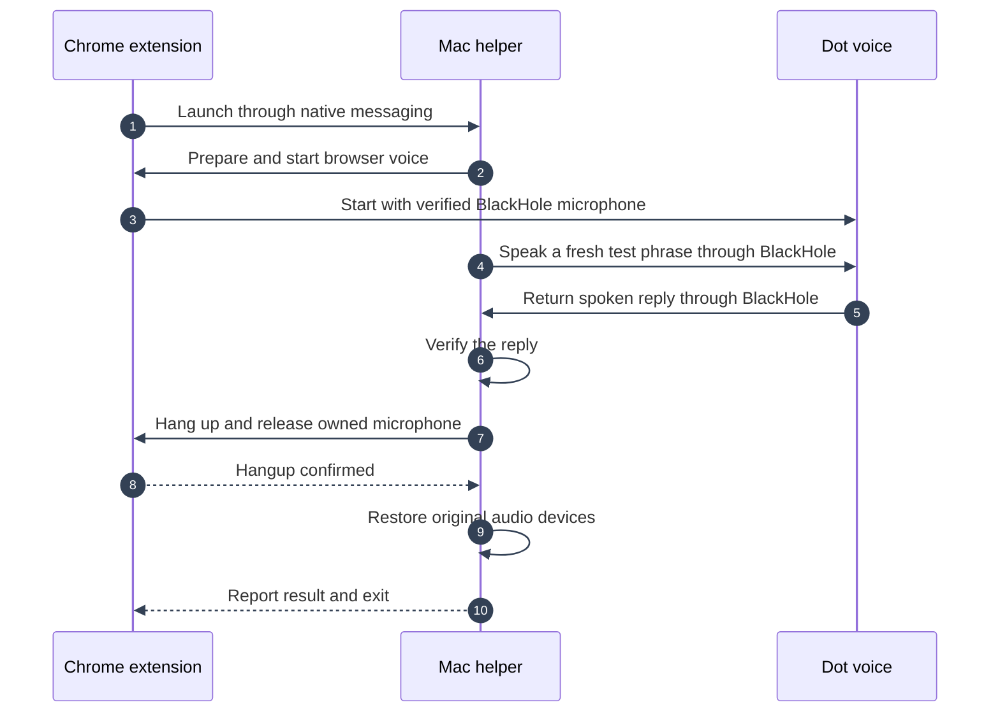
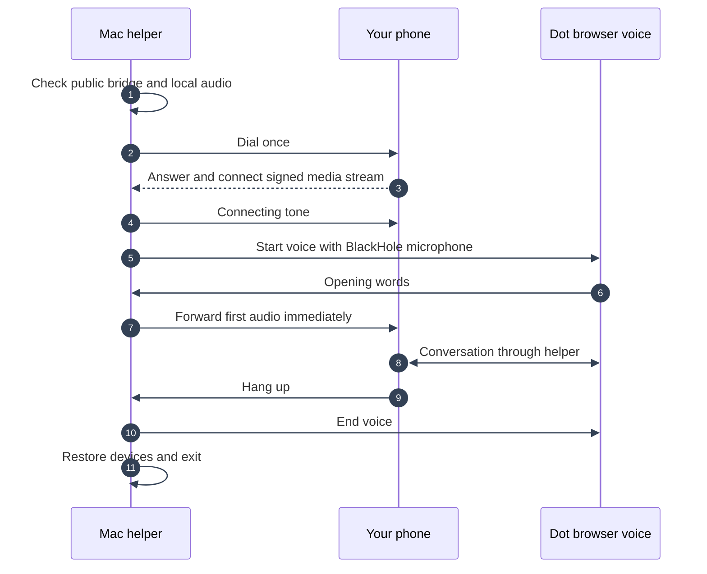
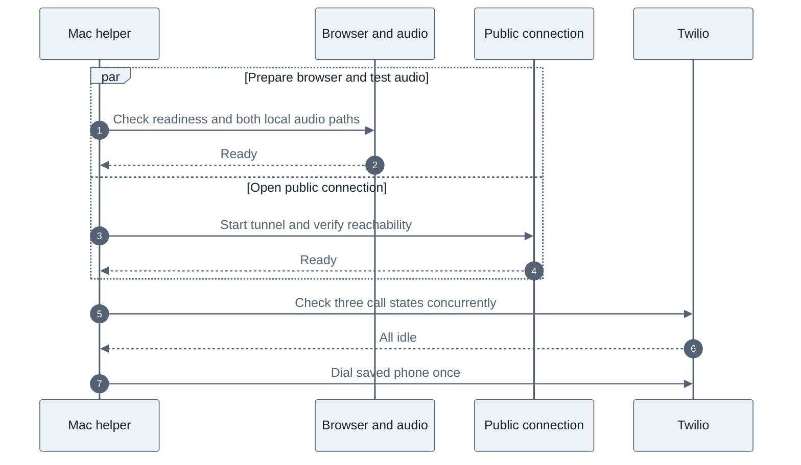

> Historical source-project notes. These describe earlier tests and transports, not an activated installation of this project. Use the root README for current status.

# On-demand Mac audio helper

Chrome now starts the Mac helper when an operation needs audio and releases it
when the operation finishes. Launching the app manually still enters the legacy
mode, so leave it closed when using the native helper. The app bundle remains installed because it owns
macOS microphone permission. It does not need a permanent menu-bar process or a
login launcher. Chrome, a signed-in Dot session, and an awake Mac are still needed.

The extension controls Dot's visible browser call interface and checks the live
BlackHole microphone track. The helper switches audio devices, runs the existing
audio bridge and audio check, and restores the original devices. Cloudflare keeps
the authenticated call queue. Ordinary calls check both local BlackHole paths and
the public bridge, ring the phone, then start Dot after the phone answers. A
connecting tone fills the wait for Dot's first speech. The spoken challenge below
is now a separate diagnostic, so it cannot consume an ordinary call's greeting.



For example, the first live Chrome-launched test sent “yellow, garden, eagle”
with an instruction to reverse the order. The captured reply was “Eagle, Garden,
Yellow.” The helper then confirmed browser hangup, restored the MacBook Pro
microphone and speakers, and exited. No phone call or public tunnel was involved.

## Installation and testing

Build the existing permission-owning app and register the native host:

```sh
python3 scripts/build-mac-app.py
python3 scripts/install-native-host.py
node scripts/build-mac-extension.mjs --audio-test
```

Reload only the unpacked extension. Version 0.1.7 automatically refreshes inactive
Dot tabs when their microphone hook is outdated, before voice initializes. It
preserves active calls and unsent drafts. This build runs one automatic diagnostic
after the page is ready. It cannot poll the cloud queue for phone calls. The diagnostic never
invokes the telephone bridge or creates a public tunnel.

The private result is `.runtime/native-helper-result.json`. Check `verified`,
`dialed: false`, `cleanup_ok`, and `audio_restored`. Check that neither `DotPhone`
nor `mac-bridge/native_host.py` remains running. A result message alone does not
prove process exit. The extension records `lastHelperExit` after the native port
disconnects. `.runtime/audio-routing status` reports the current default devices.

After a successful no-phone test, disable the old login launcher:

```sh
python3 scripts/install-native-host.py --disable-login-agent
```

The installer validates the old launcher's executable paths and keeps a private
backup in `.runtime/legacy-companion-launch-agent.plist`. It does not affect the
separate personal-calls service.

Phone calling remains disabled in the test build. Building with `--enable-calling`
and reloading the extension enables queue polling. Do not enable it as part of a
no-phone test. A build with neither flag starts no automatic diagnostic and cannot
claim phone jobs.

## Lifetime and recovery

Chrome's supported `runtime.connectNative` API launches the fixed signed app
executable. The host registration allows only this paired extension ID. The
native protocol accepts a single bounded operation, not arbitrary commands or
paths. Cloud credentials stay in the extension background worker and private
configuration, never in Dot's page. Native stdout contains framed JSON only;
Python and subprocess logs go to a private file.

When calling is enabled, Chrome polls the existing authenticated queue every five
seconds. Its extension API activity keeps the worker awake; a thirty-second alarm
and startup listener resume polling if Chrome restarts the worker. This keeps the
extension active while the Mac helper is absent. Restart recovery can therefore
have an additional alarm delay. Chrome quitting or Mac sleep makes calling
unavailable; this is not a remote service.

During a call, the helper uses the extension's stable queue instance ID and owns
cloud heartbeats and cancellation checks. The extension pauses idle polling
until the helper exits. A claimed job is never automatically replayed after a
failure. Diagnostics never claim a queued job.

The extension persists ownership before launching the helper. A pipe disconnect,
process crash, or unsuccessful cleanup retains that recovery marker and blocks
new work. The next startup launches a recovery operation, confirms browser hangup,
and then restores the saved devices. If browser hangup cannot be confirmed,
BlackHole routing remains in place to prevent accidental physical microphone
capture. A bounded operation timeout requests cancellation and then disconnects
an unresponsive native port.

## Validation scope

The automated tests cover framing, malformed and oversized input, allowed
operations, concurrent launch rejection, diagnostic isolation from dialing,
process-exit confirmation, safe audio restoration after browser hangup, and automatic
page refresh that preserves active calls and unsent drafts.
The existing browser microphone, cloud queue, tunnel, and audio preflight tests
remain in place.

The first live test passed in 38.94 seconds, including browser startup and cleanup.
Its fresh challenge was `yellow garden eagle`, and the captured response was
`Eagle, Garden, Yellow.` A repeat on version 0.1.6 returned speech but failed the
strict check: the recognizer produced `Piger, Garden, Yellow.` for an expected
`tiger garden yellow`. That suggests a recognition error, but the discarded audio
was not available to confirm it. The failed test still hung up, restored audio,
and exited. This intermittent recognition failure remains a limitation; the
checker has not been relaxed to accept the misspelling.

Version 0.1.7 adds automatic page refresh, covered by tests for stale hooks,
current hooks, active calls, and unsent drafts. Its live native-helper test passed
in 39.55 seconds. Dot received `yellow river dolphin` and returned `Dolphin River
Yellow.` The extension reported verified BlackHole input, a connected browser
call, and confirmed hangup. System device inspection showed the MacBook Pro
microphone and speakers restored, and process inspection found neither helper
process running. The legacy login launcher was disabled for this test.

The final automated suites passed: 44 JavaScript tests and 53 Python tests.
Phone calling was disabled for the validation runs above. No telephone
call was made during any of these tests.

Live validation covers Chrome launching the helper, Dot receiving a fresh spoken
challenge, the helper recognizing Dot's reply, automatic browser hangup, restored
system devices, and process exit. It does not establish phone or public-tunnel
behavior for this version, since no phone call was authorized for these tests.
The audio metrics include startup queue overflow while waiting for browser voice;
a successful challenge proves the round trip, not lossless audio throughout startup.

References: [Chrome native messaging](https://developer.chrome.com/docs/extensions/develop/concepts/native-messaging)
and [extension worker lifetime](https://developer.chrome.com/docs/extensions/develop/concepts/service-workers/lifecycle).

## Answer before starting Dot, 24 October 2026

The previous live call spent 8.12 seconds opening the public bridge and 21.87
seconds checking Dot's spoken response. Its greeting was drained during that
check. The new local route check measured 3.87 seconds through the installed
permission-owning app, reducing that check by about 18 seconds. This is a component
measurement, not a measured improvement to carrier ring time.



The authenticated media start triggers Dot exactly once. Incoming phone speech
is held back until Dot's microphone is verified. Outgoing audio is streamed from
the first packet, including speech arriving just before the browser's connected
check returns. No greeting is recorded or replayed. A failed Dot start ends the
phone call. No Dot speech for 15 seconds after connection also ends it with a
diagnostic failure. No answer means Dot never starts.

`end_owner_call` now accepts an omitted `call_id` and selects the owner's active
call. Supplying a stale ID never cancels a different call. Tool instructions tell
Dot to invoke the tool when asked to hang up, rather than merely acknowledge.
The reported failed spoken hangup had `cancel_requested: false`, which confirms
no cancellation reached the queue. It does not establish why voice mode omitted
the tool, or prove that voice mode will invoke it after this update.

Validation uses signed simulated phone streams, a real MCP client, and the local
Worker OAuth flow. It covers first-audio forwarding, a connecting tone, startup
failure, cancellation during startup, no spoken check before ordinary dialing,
and hangup without an ID. The installed app's local route test verified both
virtual audio directions and clean exit without dialing or starting browser voice:

```sh
.venv/bin/python scripts/test-native-audio-route.py
```

An actual phone call, its ring timing, and Dot's spoken invocation of the hangup
tool remain to be verified. Existing extension version 0.1.7 loads the updated
Python helper on its next operation, so this change needs no extension reload.

Final verification passed 47 JavaScript tests and 59 Python tests, including the
local Worker OAuth integration check. Deployment
`8e0a9d59-ccdf-4ae9-b821-c8567e50e1c4` exposes the optional hangup call ID and
returns the new call sequence in live readiness. The Durable Object initially
returned the previous wording during deployment propagation; the final read
confirmed the updated code, Chrome online, and no active call.

## Parallel startup, 24 October 2026

Public connection setup now runs alongside browser preparation and the local
audio check. Browser preparation must still reject an existing voice session
before test tones start. Both branches must succeed before routing changes or
dialing. Failure or cancellation waits for audio peers and tunnel startup to
unwind, and closes any tunnel that already opened.

The three Twilio checks for queued, ringing, and in-progress calls now run
concurrently. All must pass before the single dial request. The signed public
bridge check remains in place. Dot still starts only after the phone answers,
so this change does not consume the greeting or alter conversation audio.



Two no-phone benchmark comparisons used the real permission-owning helper,
temporary public connections, and read-only Twilio requests. Browser preparation
was stubbed. They exclude queue pickup, actual dialing, and carrier ring time.

| Component | First serial / parallel | Repeat serial / parallel |
| --- | --- | --- |
| Public setup plus audio test | 13.07 / 7.82 s | 16.54 / 17.13 s |
| Three provider status checks | 1.07 / 0.74 s | 1.87 / 0.82 s |
| Combined measured savings | 5.58 s | 0.47 s |

The repeat's public setup slowed from 11.99 to 17.12 seconds, hiding most of the
concurrency gain. In both parallel runs the audio-test helper overlapped public
setup by about 4.5 seconds. That includes an extra test-helper launch which a
production call does not need at this stage. Audio work inside the helper took
3.84 seconds in the repeat. Combined with provider-check savings, comparable
network conditions should save approximately 4–5 seconds in production setup.
This is an estimate, not a measured improvement to phone ringing time.

Both audio directions passed, helpers exited cleanly, temporary tunnels closed,
and no phone was dialed. All 87 Python regression tests passed. Tests cover
concurrency, failed checks, cancellation cleanup, existing-call rejection,
first-audio forwarding, and exactly one simulated dial. Existing extension
version 0.1.7 launches these Python files on the next call; no reload is needed.
New `call_setup_phase` events and `setup_seconds` on dial request/creation logs
allow the next real call's helper startup to be measured without storing speech.

Reproduce with `.venv/bin/python scripts/benchmark-call-startup.py` while idle.
Results are saved in `.runtime/startup-latency.json`; the first comparison is
retained in `.runtime/startup-latency-first.json`. The extension's five-second
queue polling interval remains unchanged, as do carrier-side ringing delays.

The next live call confirmed faster ringing but again had no cancellation
request when the owner verbally asked Dot to disconnect. `cancel_requested`
remained false for `c4be024e-adef-4bbc-ad0e-c21d07a12bb9`. The owner chose to
keep hangup dependent on Dot's tools, with no local speech detector.

Call creation and progress responses now include a `hangup` control containing
`end_owner_call` and that exact call's ID, plus an instruction to invoke it on
request. This works with clients that still require an explicit ID. Completed
calls do not advertise that control. ChatGPT's installed app tools were refreshed.
An MCP regression test executes the returned control and verifies cancellation;
it does not establish that Dot's live voice model will choose to invoke it.

## Cloud readiness after activation

Local audio diagnostics do not send cloud heartbeats. After testing, build with
`--enable-calling` and reload the extension before asking Dot for a phone call.
Use the read-only `get_phone_service_status` tool to verify `mac_online` and
`can_request_native_dot_call` are true. The audio helper should remain absent
until a call is requested.

The Worker must set `MAC_COMPANION_EXTENSION_ID` to the paired extension ID.
Its origin check admits that exact extension only on `/companion/pulse` and
`/companion/update`; both endpoints still require the companion bearer token.
Other websites and extension IDs remain rejected, and the MCP/OAuth endpoints
retain their existing origin checks. The old Python client can still authenticate
without an Origin header. A local Worker regression test covers this distinction.
