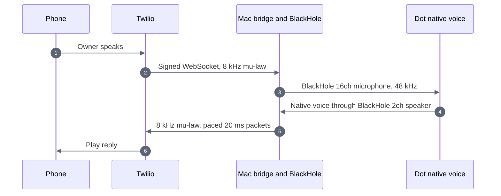

> Historical source-project notes. These describe earlier tests and transports, not an activated installation of this project. Use the root README for current status.

# Dot native audio manual test

For automatic plugin-triggered calls, see [automatic calling](AUTOMATIC-CALLS.md). This document retains the original supervised test workflow.

The Mac carries audio between Dot's browser voice session and Twilio. Dot supplies the conversation and voice. This bridge has no language model, transcription service, or speech synthesizer. Existing personal-calls Workers and the Dot Phone plugin remain intact.



For example, saying "What did we discuss earlier?" on the phone becomes microphone audio in the existing Dot session. Dot answers using its own context and voice. The bridge carries the resulting speaker audio back to the phone. It does not interpret that request or create another agent session.

## Setup

Requires macOS, Python 3.11, Xcode command-line tools, BlackHole 2ch and 16ch, and an authenticated Dot session in Chrome. Python 3.11 is intentional because the prototype uses audioop.

Install BlackHole with `brew install --cask blackhole-2ch blackhole-16ch`. If the devices do not appear, restart CoreAudio from your Terminal with `sudo killall coreaudiod`, or restart the Mac. Never share the administrator password.

From the dot-phone-call directory:

```sh
python3.11 -m venv .venv
.venv/bin/pip install -r mac-bridge/requirements.lock
swiftc -module-cache-path .runtime/swift-cache mac-bridge/routing.swift -o .runtime/audio-routing
.venv/bin/python mac-bridge/devices.py --test-loopback
.venv/bin/python -m unittest discover -s mac-bridge -p 'test_*.py' -v
```

Place the official cloudflared binary in `.runtime/bin/cloudflared`. The current local binary is version 2026.10.3, downloaded from Cloudflare's GitHub release, with the release SHA-256 verified before extraction. The bridge reads existing credentials from the sibling personal-calls `.secrets` directory, never from chat or command-line arguments.

## Run one test

Pause other Mac audio first. Default input changes to BlackHole 16ch and default output to BlackHole 2ch. Other apps using these defaults are affected. System alert output is not changed.

1. Run `.venv/bin/python mac-bridge/test-session.py`.
2. Wait for `awaiting_dot_voice`. Open the existing Dot tab and start its voice call. Wait for the connected call timer.
3. Run `touch .runtime/dot-audio-ready`. This authorizes the already-prepared single test call. Answer the phone and say hello.
4. Hang up normally. Twilio has a two-minute call limit. The launcher restores the saved Mac defaults and stops its temporary Cloudflare tunnel.
5. End Dot's browser voice session using its Hang up button. Browser startup and teardown are manual in this prototype.

The launcher waits up to three minutes for Dot readiness. Ctrl-C triggers cleanup. If the process is forcibly killed or the Mac crashes, recover the saved audio settings with:

```sh
.runtime/audio-routing restore .runtime/mac-audio-original.json
```

Do not delete the snapshot before restoration. If an original device is unavailable, reconnect it and retry. An existing snapshot blocks a second test.

## Boundaries

- Calls are restricted to the existing owner and purchased Twilio caller number. There is no public dial endpoint.
- The temporary public endpoint accepts only signed Twilio requests. The stream must also match the expected account and call. A second stream is rejected.
- Provider status callbacks and a two-second status poll stop delivery after hangup. Local stream disconnection ends the call. Call creation is never automatically retried.
- Audio stays in bounded memory buffers. The bridge does not save recordings or transcripts. Dot and Twilio retain their own normal service behavior.
- Incoming speech clears pending playback and briefly ducks outgoing audio. Dot still determines conversational turn-taking.
- Phone audio remains narrowband 8 kHz. Using Dot's native voice cannot preserve browser-quality frequency range over this Twilio Media Stream.
- This manual launcher remains available alongside the new automatic companion. Use the automatic calling guide for plugin-triggered dialing and browser startup.
- The Mac must stay awake and online. Quick Tunnels are temporary development infrastructure, not a production availability guarantee.

## Verification

Seven offline tests cover codec fidelity, resampling continuity, bounded buffers, signature rejection, expected call identity, interruption clearing, duplicate streams, and shutdown. Both installed BlackHole devices passed a 997 Hz tone loopback test. A simultaneous two-direction silence test ran with zero underruns and dropped audio. Live call results are recorded separately after the test.

### First phone test, 23 October 2026

The owner confirmed: "Yes, a clear back-and-forth conversation."

Twilio reported `completed`, duration 120 seconds. The bridge observed nonzero audio from Dot and the phone, zero CoreAudio underruns, and zero capture queue drops. The bounded incoming queue discarded 65,784 samples, about 1.37 seconds total across the call; this did not prevent the owner from reporting a clear conversation, but jitter behavior still needs longer testing. No additional LLM or speech-generation service was used.

Afterward, the launcher stopped the tunnel and restored MacBook Pro Microphone and MacBook Pro Speakers as the defaults. Dot's browser voice session was ended through its Hang up control. The existing composer draft was preserved.

This verifies one supervised native-voice phone conversation. It does not yet verify unattended calls initiated by Dot's MCP tool, long calls, recovery after sleep, or production reliability.
