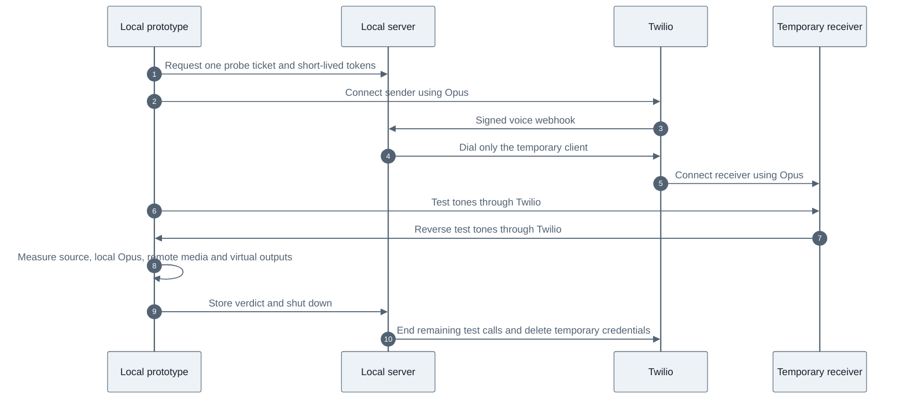

> Historical source-project notes. These describe earlier tests and transports, not an activated installation of this project. Use the root README for current status.

# Opus bridge prototype

This isolated prototype connects through Twilio Voice SDK 2.18.5 using Opus.
It has not demonstrated a wideband improvement through Twilio and is not the
production calling path. The saved phone number remains the only phone target.
Phone dialing is disabled unless the server is started with an explicit flag.

Our application controls the input stream, output device, codec preference,
and call destination. Twilio connects the call legs. A future phone test would
also depend on the carrier preserving wideband audio.

## Results, 24 October 2026

The initial four client-to-client calls were tested without dialing a phone. The final
run negotiated Opus in both directions, carried the low test tones both ways,
and had zero reported packet loss or concealed samples. Its final jitter samples
were 6 ms and 7 ms. Those measurements cover a short synthetic test, not a long
conversation or a carrier connection.

The high-frequency check failed consistently. In the final run:

| Measurement | 997 Hz | 6000 Hz |
| --- | ---: | ---: |
| Generated source | -38.1 dB | -38.0 dB |
| Local Chrome Opus loopback | -38.0 dB | -38.3 dB |
| Twilio client-to-client receive | -38.1 dB | -118.4 dB |

These are FFT peak levels with the same analyser configuration. They are not
perceived-loudness or MOS scores. The 6 kHz tone lost 0.3 dB locally and 80.4 dB
through the cloud path. In the reverse direction, the 733 Hz tone arrived at
-38.1 dB and the 6500 Hz tone at -118.1 dB.

For example, sending the two equally strong 997 Hz and 6000 Hz tones through
Chrome alone preserves both. Sending them through Twilio preserves the lower
tone but nearly removes the higher one. Selecting Opus therefore does not, by
itself, recover the missing voice detail in this tested route.

The control test rules out an inherent inability of Chrome Opus to carry these
tones. Received SDK media was measured before the virtual output devices, so
BlackHole cannot explain the cloud high-frequency loss. The packet investigation
below further isolates the loss to the Twilio media path. No negotiated
`maxplaybackrate=8000` restriction appeared in the captured codec parameters.
The 48000 Hz RTP clock is not proof of full-band audio content.

Both BlackHole devices also passed independent local loopback tests at 997 Hz
and 6000 Hz. Initially, the SDK output path to BlackHole 2ch was silent despite
reporting the selected sink. Routing the public `Call.getRemoteStream()` through
an explicit 48 kHz `AudioContext` fixed that silence. The SDK's audio elements
remain playing but muted to keep remote WebRTC decoding active without duplicate
playback. Both virtual outputs carried the low-frequency cloud test tones after
the change. The high-frequency tones remained absent from the cloud media.

Browser tracks, cloned SDK inputs, audio contexts, peer connections, temporary
Twilio keys/applications, and the public tunnel were cleaned up. No system audio
defaults were changed. Latest regression checks passed: 81 Python tests and 52
JavaScript tests, including eleven prototype policy tests and four audio-verdict tests.

## Packet investigation, 24 October 2026

Four additional browser-to-browser probes examined encoded packets and supported
configuration changes. A pass-through `RTCRtpScriptTransform` copies 50 generated
audio packets per direction, then forwards every frame unchanged. This diagnostic
is enabled only in probe mode. It never captures a saved-number call. FFmpeg
decodes the bounded packet samples locally, independently of Chrome playback.

| Variant | Outgoing 6 kHz | Incoming 6 kHz | Incoming 997 Hz |
| --- | ---: | ---: | ---: |
| 40 kbps, answer on bridge | -24.77 | -109.60 | -24.96 |
| 128 kbps, answer on bridge | -24.50 | -117.52 | -24.91 |
| 40 kbps, answer immediately | -24.77 | -107.81 | -24.95 |

These are decoded FFT peak levels in dBFS, using a different normalization from
the browser analyser table above. Compare rows within each table. Reverse-direction
6500 Hz tones show the same loss. Higher tones exist in outgoing encoded packets
and are already absent from incoming encoded packets, before browser decoding or
BlackHole playback. At 128 kbps, incoming packet headers even indicate 20 kHz
bandwidth, yet the decoded contents still lack the high tone.

Increasing the supported bitrate and changing `answerOnBridge` did not restore
the tones. The immediate-answer variant also had silent virtual-device output,
so it is not a candidate replacement. No tested setting improved voice detail.
This evidence locates the loss within Twilio's media path, but does not identify
its internal processing component, account policy, or whether treatment differs
for natural speech. The probes establish neither a subjective quality score nor
wideband delivery to the saved phone number. Production remains unchanged.

Reproduce the timing comparison with `--answer-immediately`; it affects only the
temporary-client probe. Select 40 or 128 kbps in the page before starting.
Analyze a saved report with:

```sh
.venv/bin/python scripts/analyze-opus-packets.py .runtime/opus-prototype-result.json
```

Evidence is in `.runtime/opus-packets-baseline.json`, `opus-packets-128k.json`, and
`opus-packets-immediate-answer.json`, alongside their `-analysis.json` files.
The last probe parent is `CAc871c8b29b6aedeafd88971d47e881e6`; its sole child is
`CA1eda8bf5baaf0129dfd81885e51b9d87`. Both completed and the child destination was
a temporary client. `.runtime/opus-filter-call-audit.json` records that check.
`.runtime/opus-filter-proof.png` shows the failed high-frequency check with phone
dialing disabled. Cleanup succeeded, temporary credentials were deleted, and
ports 8893 and 8894 closed. No support request has been sent.

## Test flow



## Running

From the repository root, using the existing Python environment and installed
Node dependencies:

```sh
.venv/bin/python mac-bridge/opus_prototype.py
```

Open `http://127.0.0.1:8893` in Chrome, allow microphone access for BlackHole
enumeration, and click **Run no-phone Opus test**. One Twilio probe is allowed per
server session. Restart the server for another cloud probe. The local Opus and
virtual-device buttons isolate those components without making a Twilio call.
Reload the page between tests because completed tests close all audio contexts.

Click **Shut down prototype** when finished. SIGINT/SIGTERM and a 15-minute
server lifetime also trigger cleanup. If the process is forcibly killed, its
resource manifest remains in `.runtime/opus-prototype-resources.json`; clean up
those recorded resources before restarting. Startup refuses to overwrite it.

The optional `--enable-owner-dial` flag exposes a separate manual saved-number
button. It was not used in these tests. That mode captures BlackHole 2ch and
returns phone audio to BlackHole 16ch. It does not yet orchestrate Dot startup,
change/restore system defaults, or integrate with the extension/MCP lifecycle.
Do not replace production with this prototype until those flows are implemented
and tested. Existing production calls still use the Media Streams bridge.

## Boundaries and evidence

- UI and tokens bind only to loopback port 8893. The tunnel exposes port 8894,
  which accepts only signed Twilio voice/status callbacks.
- Host/Origin checks protect local token issuance. Tokens expire after ten
  minutes. The receiving client has no outgoing grant.
- A random ticket is bound to one parent call. Probe mode can generate only
  `<Client>` TwiML for its own temporary receiver. Browser-supplied `To` values
  cannot choose a destination. The phone route requires the server flag and
  always uses the existing saved number.
- No call recordings are enabled. Test media contains generated tones.
- Reports keep codec SDP lines only, excluding ICE credentials and network
  addresses. `.runtime/opus-prototype-result.json` contains the final result and
  cleanup status. Earlier controls are saved as `.runtime/opus-local-reference.json`
  and `.runtime/opus-virtual-devices.json`. The screenshot is
  `.runtime/opus-prototype-proof.png`.
- `.runtime/opus-call-audit.json` confirms four completed parent calls, each with
  exactly one completed temporary-client child. No child destination was a
  phone number. The final parent is `CA14d979ddcd34e1835fd9782c533844ae` and its
  child is `CAbeafe1e5778eb24c3a103269a849306c`.
- Voice Insights partial-summary requests for those two call legs returned
  HTTP 404, code 20404. No downsampling tag was available to confirm the cloud
  cause. No paid Insights features were enabled.

The next useful step is to identify why this account's client-to-client path
filters the high-frequency tones, using the probe call IDs with Twilio's call
diagnostics or support. A phone call is not needed to reproduce that problem.
Even after it is resolved, wideband on the existing number must be measured on
the carrier leg. No overall quality-improvement percentage is established.

Twilio recommends Opus and documents its bitrate controls in
[Voice SDK supported codecs](https://help.twilio.com/articles/13527980995355-Twilio-Voice-SDKs-Supported-Audio-Codecs).
Its [Voice Insights FAQ](https://www.twilio.com/docs/voice/voice-insights/frequently-asked-questions#why-was-this-call-tagged-downsampled)
explains that an HD codec connection can still be downsampled by another
component. That is consistent with the observations but does not identify the
specific component responsible here.
