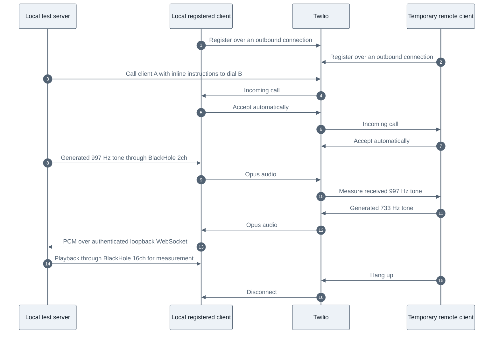

> Historical source-project notes. These describe earlier tests and transports, not an activated installation of this project. Use the root README for current status.

# Registered Twilio client prototype

Two fresh-start tests passed on 25 October 2026 without clicking the page.
Generated audio crossed Twilio in both directions and traversed BlackHole 2ch
and 16ch. The test uses no Cloudflare connection, public webhook, TwiML
application, DNS change, or phone-number call. Production remains unchanged.

The local application registers two temporary Twilio clients. It then makes a
REST call to the first client with inline instructions to dial the second.
Both clients accept automatically. No browser-supplied destination is accepted,
and the server does not load the saved phone number.



## Results

The two successful runs are `.runtime/registered-probe-pass-1.json` and
`.runtime/registered-probe-pass-2.json`. Each includes Twilio call IDs and an
audit confirming both destinations were temporary clients and both legs ended.

| Check | First run | Fresh server and fresh tab |
| --- | --- | --- |
| User activation at start and finish | false | false |
| Microphone permission already granted | yes | yes |
| Registration, token replacement, re-registration | passed | passed |
| Forward tone at source / remote client | -38.1 / -38.1 dB | -38.1 / -38.0 to -38.1 dB |
| Return tone at remote stream / BlackHole capture | -38.0 / -41.8 dB | -38.0 / -41.7 to -41.8 dB |
| Reported inbound packet loss | 0 both clients | 0 both clients |
| Reported concealed samples | 0 both clients | 0 both clients |
| Dropped local PCM chunks | 0 | 0 |
| Remote hangup and resource cleanup | passed | passed |

Levels are FFT peak readings for generated tones, not loudness scores or speech
quality ratings. Each run collected four measurements over eight seconds.
These narrowband tones do not establish a wideband improvement. The earlier
[Opus investigation](../opus/README.md) still applies.

An additional interrupted-helper test passed after fixing shutdown order. The
server now closes its audio WebSocket before waiting for HTTP cleanup. The
browser detects that closure, disconnects both clients, and releases its tracks,
contexts, and peer connections. `.runtime/registered-probe-interrupted.json`
records the expected aborted-test verdict, completed call legs, and successful
cleanup. An interrupted test must not be reported as an audio pass.

The normal MacBook microphone and speakers remained selected after testing.
The prototype listener closed, temporary API keys were deleted, and the hosted
fallback still reported online and ready with no active call. Regression results:
71 JavaScript tests and 110 Python tests passed, including seven new probe policy
and local audio-socket tests.

## Chrome output finding

Direct Chrome playback into BlackHole was silent despite running AudioContexts,
advancing clocks, matching sink IDs, and live unmuted capture tracks. The same
local loopback failed both without a click and with a click. Opening a second
input was not necessary to reproduce it.

A native-generated tone was captured correctly by Chrome and delivered through
Twilio. The return tone was also present in Chrome's remote WebRTC stream, but
absent from BlackHole. This isolates the observed failure to Chrome's output
path in this environment. Its underlying cause, including possible tab/site
muting, remains unconfirmed.

The working variant sends received PCM to the local Python process for playback.
It uses 48 kHz mono, 20 ms chunks, and a bounded 12-chunk queue that drops the
oldest chunk on overflow. An AudioWorklet runs in a silent context; it does not
depend on audible Chrome playout. The native output writes to BlackHole 16ch.
Chrome still captures BlackHole 2ch. No default-device changes are required by
this synthetic test, and Python does not capture a microphone.

The localhost socket requires the exact Origin and a random per-run capability.
It accepts only one connection and finite, correctly sized PCM frames. The
prototype also takes the existing native helper audio lock to prevent concurrent
use of the same devices. These are test boundaries, not a completed production
audio transport with interruption buffering and long-call recovery.

## Reproduce

From the repository root:

```sh
.venv/bin/python mac-bridge/registered_probe.py --native-audio
```

Open `http://127.0.0.1:8893/` in Chrome. The page runs automatically using existing
microphone permission. It refuses to prompt or manufacture a user gesture. It
creates one temporary client-to-client call, measures audio, hangs up, and stops
the server. The server also stops after five minutes or on SIGINT/SIGTERM.

Without `--native-audio`, the test reproduces the direct Chrome output control.
The `?manual=1` page offers a clicked control, which cannot qualify as unattended
startup. `?source=native` is a diagnostic mode for an independently generated
BlackHole 2ch source; it does not enable native return playback.

If `.runtime/registered-probe-resources.json` remains after a crash, inspect and
clean up its recorded temporary clients/key before another run. Startup refuses
to overwrite it. Calls have a 60-second parent limit and a 45-second child limit.
Do not remove the manifest merely to bypass the safeguard.

## What this establishes, and what it does not

Fresh server and fresh tab startup, without a click, is demonstrated in the
existing Chrome profile after microphone permission was previously granted.
Explicit token replacement and re-registration passed. Actual token expiry,
browser restart, Mac login/reboot, sleep/wake, background suspension, network
loss, and automatic extension/native-host launch have not been tested here.

The fixtures simulate both ends of the audio route. This run did not start Dot
voice, place a phone call, exercise a carrier leg, or configure inbound calling
and PIN handling. It does not replace the production extension or MCP connection.
The OpenAI MCP tunnel was verified separately in `SECURE-TUNNEL-TEST.md`.

The supported building blocks are documented in Twilio's
[Device registration API](https://www.twilio.com/docs/voice/sdks/javascript/twiliodevice),
[Calls API with inline TwiML](https://www.twilio.com/docs/voice/api/call-resource), and
[Client dialing instructions](https://www.twilio.com/docs/voice/twiml/client).

## Supervised phone test, 25 October 2026

Two owner-authorized calls used the registered-client audio path. On the second
call the owner confirmed clear audio in both directions. The first included
unwanted music because YouTube Music was playing into the Mac's shared output.
The music tab was closed before the second call. This confirms a routing
limitation: until Dot has a dedicated output route, other Mac audio can enter
the phone call. Pausing or closing a player is a temporary mitigation.

This live test retains the existing hosted MCP queue solely for launching and
controlling the paired extension/native helper. The helper selects the new audio
transport only when a short-lived local arm file matches the exact queued job
ID. That file is consumed once. All ordinary calls continue using the existing
transport. No extension reload or hosted deployment was needed.

The phone is dialed through the REST API with inline instructions to connect to
one registered client. Dot starts after the client has accepted and its local
audio output is ready. Only the saved owner number is accepted; the browser
cannot supply a destination. Recording is disabled, duration is bounded, and
the helper refuses automatic retries after an uncertain creation result.

The implementation is in `mac-bridge/registered_owner.py` and
`prototype/registered/owner.js`. It uses the existing native helper's microphone
guard, Dot controls, audio-device restoration, cloud cancellation, and ownership
lock. Temporary Twilio keys and call legs are cleaned up on exit. Unlike the
synthetic probe, the live variant never generates test tones into an active call.

This is a successful supervised live audio test, not a completed migration to an
entirely local control path. Opening the local bridge page is still supervised.
Full unattended launch, Dot-only output isolation, local queue activation, and
inbound phone routing remain separate integration work.
